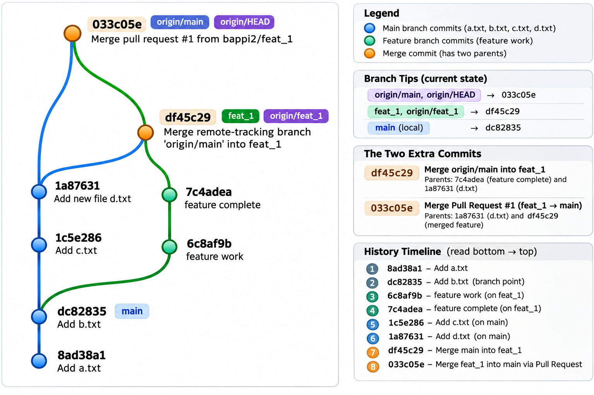

# GitRebasePractice

A hands-on repository for learning and practicing Git branching, merging, rebasing, and GitHub Pull Requests.

## Branches

- **main** — Primary branch.
- **feat_1** — Feature branch created from `main`.

## Commit History

The repository includes:

- Initial commits adding `a.txt` and `b.txt`.
- Two feature commits on `feat_1`.
- Two additional commits on `main` adding `c.txt` and `d.txt`.
- A merge of `origin/main` into `feat_1` (`df45c29`).
- A GitHub Pull Request (#1) merging `feat_1` into `main` (`033c05e`).

### Git Merge Commit Graph



## Useful Git Commands

```bash
git fetch origin                    # Fetch remote changes
git branch -avv                      # View local and remote branches
git log --oneline --graph --all --decorate  # Visualize commit history
git switch -c feat_1                 # Create a feature branch
git merge origin/main                # Merge main into current branch
git rebase origin/main               # Rebase current branch onto main
git push -u origin feat_1            # Publish feature branch
git pull origin main                 # Update local main (when on main)
```

## Key Takeaways

- **Merge** preserves existing commits and can create a merge commit.
- **Rebase** replays commits onto a new base, creating a linear history with new commit IDs.
- **Pull Requests** allow changes to be reviewed and merged through GitHub.
- **Fast-forward merges** move the branch pointer without creating an additional merge commit.
  
